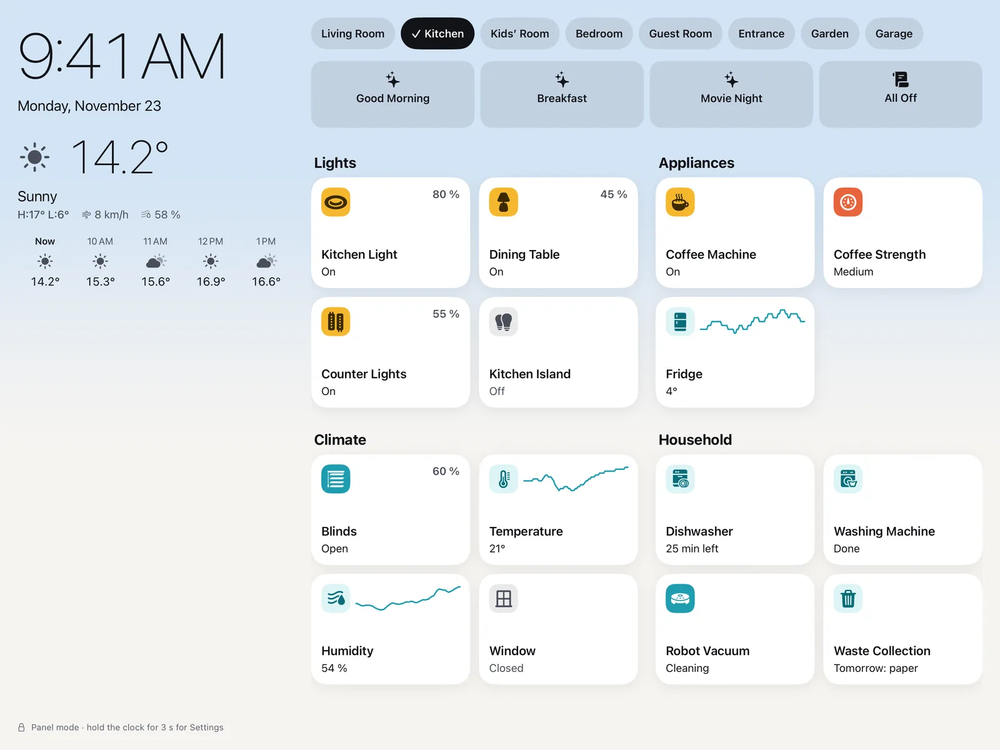
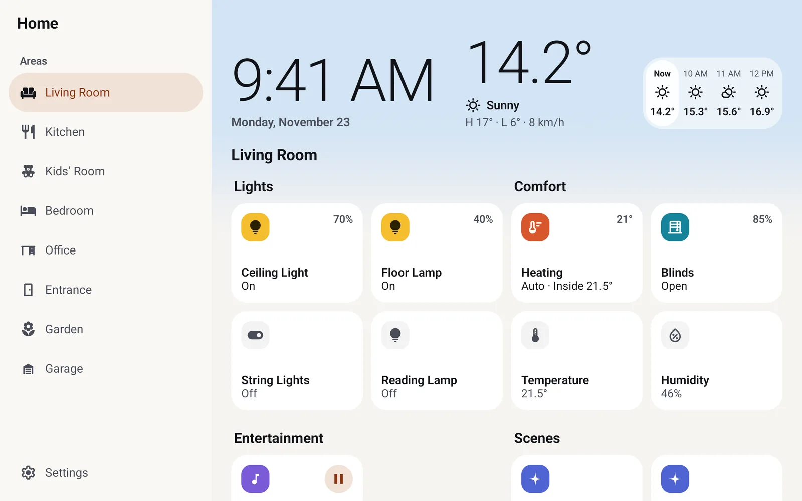

# Halumar integration for Home Assistant

Halumar gives every device in a home its own, limited view of Home Assistant: a wall panel, a
guest's phone, a child's tablet or a TV sees and controls only what an administrator allows. This
repository is the Home Assistant custom integration (domain `halumar`). It connects Home Assistant
with the Halumar Hub, creates one restricted Home Assistant user per paired device, checks what
those devices may switch, and shows the hub and the devices as Home Assistant devices with
entities, actions and events.

It is for Home Assistant administrators who already run, or want to run, the Halumar Hub app
(add-on).

<p>
  
  
</p>

The screenshots show the apps in wall panel mode in a demo home. The integration itself has no
screen of its own: it adds devices, entities, actions and events to Home Assistant.

## Status

The current version is in [`manifest.json`](custom_components/halumar/manifest.json), the changes
are in [CHANGELOG.md](https://github.com/Halumar/integration/blob/main/CHANGELOG.md). The protocol between hub, integration and apps is defined in
[Halumar/contracts](https://github.com/Halumar/contracts); the integration is built against the tag
in [`.github/contracts-ref`](.github/contracts-ref).

## Requirements

| Part | Version | Where it is defined |
|---|---|---|
| Home Assistant | 2025.11.0 or later | [`hacs.json`](hacs.json); CI tests 2025.11, the current release and the newest pre-release |
| Halumar Hub app | 2026.12.0 or later (older hubs raise a repair) | `MIN_ADDON_VERSION` in [`const.py`](custom_components/halumar/const.py) |
| Installation type | Home Assistant OS, or another installation with the Supervisor that can run apps, because the hub is a Home Assistant app | [Halumar/hub](https://github.com/Halumar/hub) |
| Python packages | none (`requirements` is empty in the manifest) | [`manifest.json`](custom_components/halumar/manifest.json) |

The Halumar apps for iPhone, iPad, Apple TV and Apple Watch are in beta and available through
TestFlight: <https://testflight.apple.com/join/fHX7YT8v>. The apps for Android phone, tablet (wall
panel) and Android TV are not available yet.

## Installation

Install the integration through the Marketplace (Home Assistant 2026.11 and newer) or HACS (older
versions). Halumar is not in their catalog yet, so you add this repository from its link. This
button opens the repository in the Marketplace, or in HACS before Home Assistant 2026.11:

[](https://my.home-assistant.io/redirect/hacs_repository/?owner=Halumar&repository=integration&category=integration)

### With the Marketplace (Home Assistant 2026.11 and newer)

1. Go to **Settings > Marketplace**. The first time, the Marketplace shows a warning that its
   content is made by the community and not reviewed or supported by the Home Assistant project.
   Nothing can be installed until you accept it.
2. In the upper-right corner, select **Add from link**. Under **GitHub link**, enter
   `https://github.com/Halumar/integration` and select **Add**. Adding a repository from a link
   needs a GitHub connection; if there is none yet, the Marketplace asks you to connect GitHub.
3. Open **Halumar** in the list, select **Install**, check the version and select **Install**.
   No restart is needed: when the installation is done, the setup page of the integration opens.
   Continue with [Set up](#set-up).

### With HACS (older Home Assistant versions)

1. In HACS, add `https://github.com/Halumar/integration` as a custom repository of the type
   **Integration**.
2. Open **Halumar** in HACS and download it.
3. Restart Home Assistant, then continue with [Set up](#set-up).

### Manually

1. Download the release zip (`halumar.zip`) from the
   [releases page](https://github.com/Halumar/integration/releases), or copy the folder
   `custom_components/halumar/` from this repository.
2. Put the files into `<config>/custom_components/halumar/` of your Home Assistant.
3. Restart Home Assistant.

Updates appear under **Settings > Updates** (Marketplace) or in HACS. Details, updates and
removal: [docs/installation.md](https://github.com/Halumar/integration/blob/main/docs/installation.md).

## Set up

1. Install and start the Halumar Hub app ([Halumar/hub](https://github.com/Halumar/hub)).
2. The hub announces itself to Home Assistant at every start. Home Assistant then offers the
   discovered **Halumar Hub** under **Settings > Devices & services**; confirm it there. When you
   open the setup yourself (it opens after a Marketplace install, or use the button below) while
   the hub is running, it asks for the same confirmation.
3. Host, port and the integration token come from the hub. The hub creates a new token at every
   start and hands it over by itself; you never copy it.

[](https://my.home-assistant.io/redirect/config_flow_start/?domain=halumar)

If the setup asks for host, port and token, Home Assistant found no running hub. Start the Halumar
Hub app, then open the setup again under **Settings > Devices & services** or restart Home
Assistant. You can also fill in the form by hand (host, port, token, HTTPS), for a hub that runs
elsewhere.

Every step, the options and reconfiguring are described in
[docs/configuration.md](https://github.com/Halumar/integration/blob/main/docs/configuration.md).

Only one Halumar entry per Home Assistant is supported.

## First steps

1. Pair a device: press **Start pairing** on the **Halumar Hub** device (administrators only), or
   use the pairing screen in the hub's panel. The pairing code is shown in the hub's panel. Home
   Assistant shows it only if you turn on the hub's option `pairing_qr_camera`: then the camera
   **Pairing status** of the **Halumar Hub** device shows the QR code while a pairing window is
   open (with `guests` only for guest windows). See
   [docs/entities.md](https://github.com/Halumar/integration/blob/main/docs/entities.md#halumar-hub-device).
2. Once the device is paired, the integration creates a Home Assistant user for it, named
   `Halumar · <device>` (guests: `Halumar · Guest <device>`), and a device with entities such as
   **Connected**, **Current area** and **Location**.
3. Decide in the hub what the device may see and switch (its profile). The integration receives
   these rules and checks them in Home Assistant.

What the integration creates is listed in [docs/entities.md](https://github.com/Halumar/integration/blob/main/docs/entities.md),
[docs/actions.md](https://github.com/Halumar/integration/blob/main/docs/actions.md) and [docs/events.md](https://github.com/Halumar/integration/blob/main/docs/events.md).

## How the parts fit together

```text
 Halumar apps (phone, tablet, wall panel, TV, watch)
   |                                   |
   | local WebSocket                   | Home Assistant API with the device's own token
   | (pairing, profile, areas;         | (reads states; switches through halumar.control.
   |  on Hub only also states and      |  A device on Hub only connects here only when it
   |  switching)                       |  has remote access)
   v                                   v
 Halumar Hub app  <---- REST /api/integration/* + WebSocket ---->  Halumar integration
 (profiles, rules,       (integration token, renewed at              (inside Home Assistant:
  pairing, editor)         every hub start)                          device users, rule checks,
                                                                     entities, actions, events)
```

*Hub only* is the strictest level of Home Assistant access; see
[Security model in brief](#security-model-in-brief).

The hub decides the rules and resolves every device's profile into a rule snapshot. The
integration stores these snapshots and checks them inside Home Assistant, also while the hub is not
reachable. For a device on Hub only the hub itself calls `halumar.control` with the device's own
token, and the same checks apply. More: [docs/architecture.md](https://github.com/Halumar/integration/blob/main/docs/architecture.md).

## Security model in brief

- Every paired device has its own Home Assistant user: never an administrator, no password, one
  long-lived token. It is local only unless the hub allows remote access for that device.
- Each device's profile in the hub sets its **Home Assistant access**:
  - **Hub only**: the device gets no Home Assistant key. It reads and switches only through the
    hub, which gives it only what its profile allows, and only at home. The hub switches for it
    through `halumar.control`. With remote access the device gets a read-only key.
  - **Checked**: a read-only key. The device switches only through `halumar.control`, which checks
    its rules first.
  - **Direct**: the rights of a normal user; the rules are applied by the app.
- A device that holds a key (Checked, Direct, or Hub only with remote access) can read every state
  in Home Assistant. Only a device on Hub only without remote access is limited to what the hub
  gives it. Apple TV, Android TV and Apple Watch always hold a read-only key.
- Guests and children are on Hub only or Checked, never on Direct. Parental controls need Halumar
  Pro in the app on the child's device; the integration enforces the rules either way.
- Limits you should know: Home Assistant lets every signed-in user read every entity, and it runs
  actions that are not tied to an entity for every signed-in user, also read-only ones. Halumar
  cannot block those actions; it detects them and reports them with a repair.

The full description, including what is checked where and what is not, is in
[docs/security-model.md](https://github.com/Halumar/integration/blob/main/docs/security-model.md).

## Documentation

All guides are listed in [docs/README.md](https://github.com/Halumar/integration/blob/main/docs/README.md): installation, configuration, concepts,
entities, actions, events and repairs, automations, security model, troubleshooting, architecture
and releases.

## Related repositories

- [Halumar/hub](https://github.com/Halumar/hub): the Halumar Hub app for Home Assistant.
- [Halumar/contracts](https://github.com/Halumar/contracts): the shared protocol (rules, schemas,
  test vectors).

## Development

From a clean checkout, with `uv` and Python 3.14:

```sh
uv venv --python 3.14 .venv
. .venv/bin/activate
uv pip install -r requirements_test.txt -r .github/requirements-ci.txt
ruff check custom_components tests
ruff format --check custom_components tests
mypy custom_components
python -m pytest tests -p pytest_homeassistant
```

The test suite runs against the minimum Home Assistant release as well (Python 3.13,
`requirements_test_min.txt`). All checks CI runs are listed in [CONTRIBUTING.md](CONTRIBUTING.md);
the design is in [docs/architecture.md](https://github.com/Halumar/integration/blob/main/docs/architecture.md).

## How this project is built

The code is written with AI coding assistants under the direction and review of the maintainer.
Every change ships with tests, and the CI checks listed in [CONTRIBUTING.md](CONTRIBUTING.md) must
pass before it is merged. Report problems as described below.

## Reporting bugs and security issues

- Bugs: open an [issue](https://github.com/Halumar/integration/issues) and attach the diagnostics
  file of the Halumar entry (**Settings > Devices & services > Halumar >** menu **> Download
  diagnostics**). It contains no tokens, no pairing codes and no locations.
- Security problems: do not open a public issue. Use GitHub's private vulnerability reporting, see
  [SECURITY.md](https://github.com/Halumar/integration/blob/main/SECURITY.md).

## License

Apache License 2.0 ([LICENSE](https://github.com/Halumar/integration/blob/main/LICENSE), [NOTICE](https://github.com/Halumar/integration/blob/main/NOTICE)). "Halumar" and the Halumar logo are
trademarks and are not covered by the license ([TRADEMARKS.md](https://github.com/Halumar/integration/blob/main/TRADEMARKS.md)). Halumar is an
independent project and is not affiliated with or endorsed by Home Assistant or the Open Home
Foundation.
